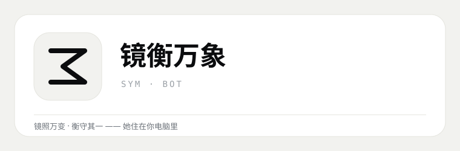
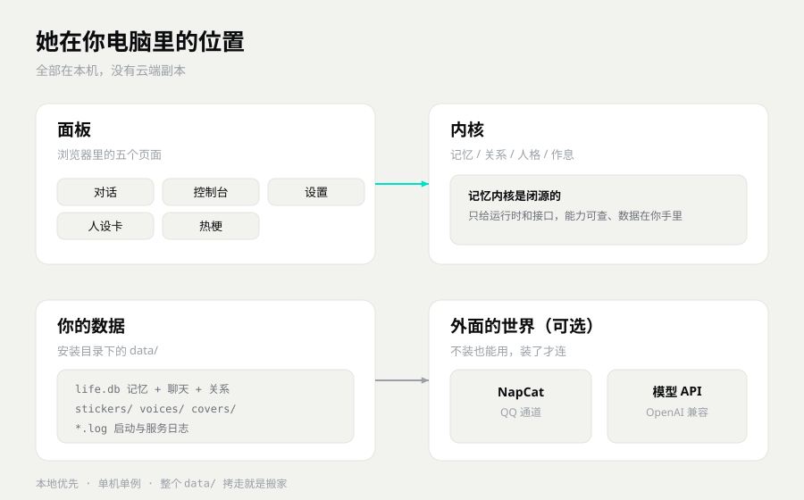
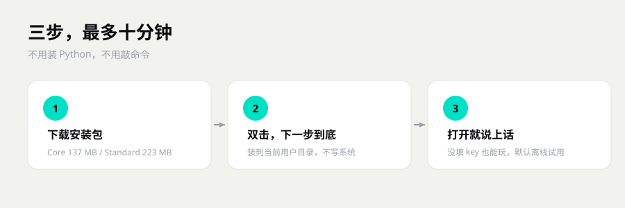
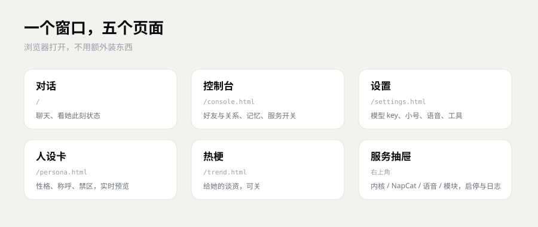
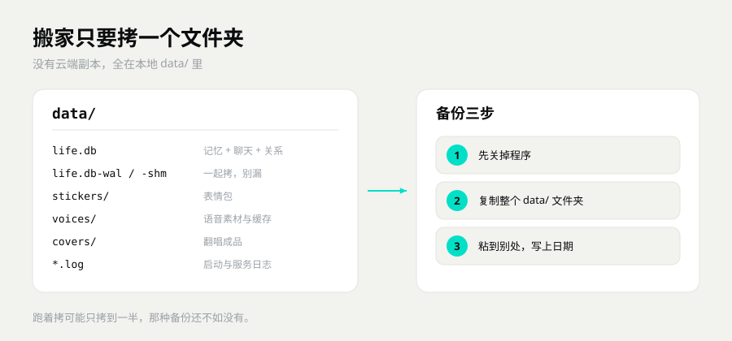

# SymBot · 衡忆数字生命

> 她住在你电脑里。有记忆，有关系，有作息，也有脾气。
> 换模型、换机器、换聊天平台，她还是她。

**下载**：[Core 安装包](https://github.com/Niko-126/SymBot/releases/latest) · [Standard 安装包](https://github.com/Niko-126/SymBot/releases/latest)（Windows 10/11）

> 前端界面还在打磨，可能还有小毛病。遇到问题欢迎开 [Issue](https://github.com/Niko-126/SymBot/issues)。

---

## 一、她不是聊天框套壳

市面上的机器人大多是这样的：你问一句，它答一句。关掉窗口，它就把你忘了。

SymBot 不是。撑着她的是四件事：

**记忆。** 她记事分轻重。你常提的，她记得牢；很久不提的，慢慢就淡了。你说「这个别忘了」，她就钉住，钉住的不淡。记的是「事」，不是原话，所以换个说法问她，她也答得上来。

**关系。** 四个数——好感、信任、吸引、反感；六个阶段——从陌生走到恋人。一段关系里只认一个恋人。表白、分手、吃醋、和好都有写死的规矩兜底，不让模型随口编。

**人格。** 性格、说话风格、每个阶段怎么称呼你、哪些词是禁区，全写在人设卡里。面板上改完立刻生效，不用重启。

**作息。** 她会困、会醒，越聊越精神。会写日记，夜里会冒点念头，到点还会主动来找你。

外加一层能插拔的通道和工具：面板直聊、QQ 私聊群聊、QQ 官方机器人，一套内核三个入口。

---

## 二、下哪个

一共两个安装包，代码完全一样，差别只在附带资源。

| 版本 | 里面有什么 | 安装包 | 适合谁 |
|---|---|---|---|
| **Core** | 程序本体 + 加密记忆内核 + 面板 + 文档 | 137 MB | 只想先试试 |
| **Standard** | Core + 表情包 + 语音触发素材 | 223 MB | 想开箱就有表情包和语音条 |

两个都装在当前用户目录（`%LOCALAPPDATA%\Programs\`），**不需要管理员权限，不写系统目录**。

装完桌面会多出一个图标，双击就是面板，**没有黑框**。关掉窗口只是收进托盘。

> 另有一个作者自用的 Full 整合包（多带了第三方语音权重，约 9.4 GB），因为涉及第三方授权，不对外发行。

---

## 三、三分钟装好

1. 下载安装包，双击。
2. 一路下一步。想改安装位置就在这一步改，默认就挺好。
3. 装完打开，就能跟她说话了。

**没有 API Key 也能跑。** 默认是试用模式：独立小库、不连 QQ、不发消息，面板、记忆、关系、日程都能玩，只是回答从本地语料里挑，不是模型说的。整条链路离线。

想让她真的说话，打开「设置 → 连接 → 模型」，填三样：接口地址、Key、模型名。保存即生效，不用重启。

详细步骤看 [上手指南](上手指南.md)。

---

## 四、面板上一共有啥

| 页面 | 能干什么 |
|---|---|
| **对话** | 和她聊天，看她此刻的状态，切群聊/私聊 |
| **控制台** | 好友与关系、记忆浏览、AI 想法、服务抽屉 |
| **设置** | 模型 Key、小号 QQ、家人名单、NapCat 目录、语音地址、工具开关 |
| **人设卡** | 性格、说话规矩、称呼表、禁区词，右边实时预览「她会怎么称呼你」 |
| **热梗** | 从 B 站抓来的梗，喂给她当谈资（可以关） |

用得最多的是右上角那个**服务抽屉**：内核状态、NapCat 登录态与二维码、语音服务、模块启停、运行环境自检，全在里头。

---

## 五、数据在你手里

数据全在安装目录下的 `data/` 里：`life.db`（记忆 + 聊天 + 关系）、表情包、语音、日志。

**备份只要记住一句**：动程序之前先关掉应用，把整个 `data/` 复制一份，`life.db-wal` 和 `life.db-shm` 一起带上。

整个目录拷走就是搬家。换台电脑，装好程序，把 `data/` 放回去，接着聊。

- 不要手改 `data/life.db`。记忆内核不开源，误操作可能让数据救不回来。
- 真弄坏了发邮件到 **mendastudio@163.com**，标题写「复活小鱼」，附上备份，作者尽力捞。

---

## 六、接 QQ 和语音（可选）

**接 QQ** 需要 [NapCat](https://github.com/NapNeko/NapCatQQ)。第三方项目，本项目不分发，自己装。装好后在面板里填 NapCat 目录和小号 QQ，点「启动」，弹 UAC 就点允许，然后扫码登录。

**语音条** 需要本地 TTS 服务，服务和权重都不随本项目分发。没有它照样能聊，只是没有语音条。

清单和各自的许可约定见 [插件与第三方](docs/插件与第三方.md)。

---

## 七、许可，说人话

- **个人免费用，不能拿去卖。**
- 记忆内核不开源，只给运行时和接口。
- 作者留的来源标记不能删、不能遮、不能伪造。
- 商用单独找作者谈：`mendastudio@163.com`。

完整条款见 [LICENSE](LICENSE)，来源与第三方声明见 [NOTICE.md](NOTICE.md)。

**记忆系统为什么闭源？** 衡忆记忆内核已经独立立项成 **Symvolve Memory**（往向量化方向走），和数字生命这条产品线的诉求不一样，所以不便开源。你现在用的这套是它的「衡忆精简严格版」，能力收了收，边界更硬。

---

## 八、文档都在哪儿

**第一次来，看这三篇就够了：**

- [一分钟看懂](一分钟看懂.md) —— 三分钟，不讲术语
- [上手指南](上手指南.md) —— 从下载到说上话，一步一图
- [常见问题](常见问题.md) —— 卡住了先翻这个

**想搞明白她怎么想的：**

- [记忆怎么工作](docs/记忆怎么工作.md) —— 记不记得住、会不会忘、能不能删
- [关系怎么长](docs/关系怎么长.md) —— 四个数、六个阶段、会吃醋也会拒绝
- [人设怎么改](docs/人设怎么改.md) —— 性格、称呼、禁区怎么调

**要动手的：**

- [安装与依赖](docs/安装与依赖.md) —— 手动装、依赖清单、环境变量
- [自己写模块](docs/自己写模块.md) —— 给内核加工具、加路由、加钩子
- [开发者文档](开发者文档.md) —— 目录地图、对话主链、测试基线、打包发布
- [常见坑](docs/常见坑.md) —— 改代码、打包、发版前扫一眼
- [路线图](路线图.md) —— 接下来打算做什么、明确不做什么

**想看对比和评测：**

- [和别的机器人比](docs/和别的机器人比.md) —— 四种形态、四组可复跑的题
- [评测标准 v1.0](docs/评测/评测标准-v1.0.md) —— 同一把尺，谁都能复跑
- [五机器人对比报告](docs/评测/五机器人对比报告.md)
- [五家小白易用性评测](docs/评测/五家小白易用性评测.md)
- [插件与记忆深度评测](docs/评测/插件与记忆深度评测.md)

---

> **SMD-P 是 SymBot 的前身。** 改名之后代码、协议、数据格式一脉相承，老的 `data/` 能直接用，先备份。

东西都在你硬盘上，别手滑删了就成。
