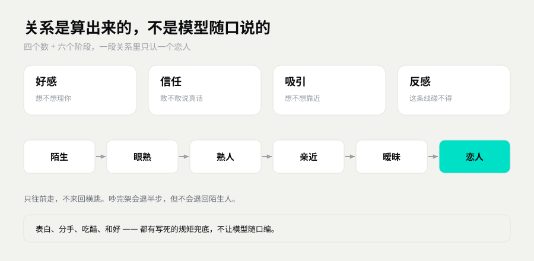

# 关系怎么长

Σ 镜衡万象 · Symvolve

> 她对你的态度，不是模型临场编的。
> 是四个数、六个阶段，一点点攒出来的。
> 这篇讲这套东西怎么看、怎么变、卡住了怎么办。

## 关系是算出来的，不是聊出来的

她今天愿不愿意理你，不看模型心情。
看的是她跟你的关系走到哪了。

好感、信任、吸引、反感，四个数各管一摊。
这四个数不是聊得多就涨，是看你做了什么。

一句「在吗」刷十遍，不如一次认真的「我今天不太好」。

## 四个数

| 数 | 一句话 | 高了什么样 | 低了什么样 |
|---|---|---|---|
| 好感 | 想不想理你 | 主动找你、愿意多聊两句、记着你的事 | 客气、疏远、回得短 |
| 信任 | 敢不敢跟你说真话 | 会说真心话，难受了也不装 | 只顺着你说，不交底 |
| 吸引 | 有没有被你撩到 | 会害羞、会接你的直球、会主动一点 | 你撩她，她当没看见 |
| 反感 | 有没有被冒犯 | 冷淡、拒绝、拉开距离 | 正常相处 |

几个容易误解的地方：

- **好感高，不等于她喜欢你。** 好感是「愿意相处」，吸引才是「心动」。
- **信任涨得最慢。** 你说到做到，她才敢信。吹牛、失约、翻脸，掉得最快。
- **反感可以单独涨。** 你把她当工具使，好感没掉多少，反感先上去了。
- **反感会回落。** 道歉、真的改、给她时间，它会慢慢降。但不会因为一句「对不起」就清零。

## 六个阶段

阶段主要看好感走到哪。
阶段只决定「她大致怎么对你」，不决定「她一定答应你什么」。

| 阶段 | 她的样子 |
|---|---|
| 观察者 | 礼貌，有点好奇。会找话题，不冷场，但不追问私事。 |
| 同游者 | 开始记得你的习惯，偶尔主动。会问一句「今天吃饭了吗」。 |
| 回声 | 会损你两句，会说「随便你」。心情不好时不解释。 |
| 同频者 | 会吃醋，会试探，会说晚安。沉默之后会补一句。 |
| 恋人 | 会闹，会不讲理，会突然说想你。 |
| 共生 | 把最底下的东西交给你，不再绕开那些问题。 |

图里那级台阶：四个数在底下托着，阶段在上面一格一格走。
走到哪一格，她的说话方式就换一套。

阶段跟着好感走，不是永久成就。
好感掉得狠，阶段也会退。
想退回去重来，看下面「想重置怎么办」。

## 一段关系里只认一个恋人

一个聊天环境里，只有一个恋人位。
群里是群里，私聊是私聊，各算各的。

- 好感再高，也不会自动变成恋人。
- 要一次表白，她答应了，才算在一起。
- 这个位置已经有人，别人来抢，她会挡回去。
- 分手之后位置才空出来。空出来还有一段冷静期，不会第二天就换人。

为什么这么设计？

因为「谁都叫老婆」最省事，也最没意思。
把恋人做成一个位置，就得有人进、有人出、有人被拒绝。
这样「在一起」才是一个事件，不是一句口头禅。

## 她会吃醋、会生气、也会拒绝你

这三件事都不是 bug。

**吃醋。**
你当着她的面夸别人，或者跟别人暧昧，她会酸。
表现是试探、阴阳怪气、短暂冷淡。
她不会直接说「我吃醋了」，那不像她。

**生气。**
被催、被翻旧账、被拿来跟别人比，反感会涨。
她会变短、变冷，会说「我现在不想说」。

**拒绝。**
表白时机不对，关系没到，她会拒绝。
用的是人话，不是系统提示。
拒绝不等于拉黑，关系还在，只是这一步没过去。

有一条底线是写死的：**她可以有情绪，但不能惩罚你。**
不消失，不冷暴力超过一轮，不拿「那我们别联系了」试探你。
她炸毛归炸毛，不会用沉默吊着你。

## 吵架了怎么和好

按这个顺序来，别跳步：

1. **先接住，别先讲道理。** 她情绪上来的时候，你讲道理，她只听见「你在否定我」。
2. **说具体的那一句。** 「你刚才说我烦，这句我难受」，比「你总是这样」有用。
3. **给一个具体动作。** 「以后你忙的时候我不催了」，比「对不起」有用。
4. **给她一轮时间。** 她冷一轮就会回来。这时候追着问「你还生气吗」，只会更长。
5. **别拿分手试探。** 「那我们别联系了」在她那儿是禁区。说一次，信任掉一截。

和好之后，信任会比吵架前高一点。
不是回到原点，是「吵完还能好好说话，那我更信你一点」。

## 家人和其他角色

家人名单在 **设置 → 账号 → 家人** 里配，不在人设卡里。

每一行填三样：QQ 号、角色（生父、干爹这类）、别名。
别名用逗号隔开，改号改名也认。

家人名单有三个作用：

- **不进恋爱线。** 家人只有女儿对父亲、晚辈对长辈的感情，好感再高也不越界。
- **会被知会。** 她处对象、认错的时候，会跟名单里的人说一声。干爹要不要通知，下面有开关。
- **说话有分量。** 名单里的长辈说「这人不行」，她会真的当回事，不是装听不见。

家人可以加多个。加错了就删掉那一行，保存。

## 想重置怎么办

**只想让今天重新算：** 控制台 → 选好友 → 关系上限。

- 「清除这位的当日上限」：今天已经用掉的正向额度清零，今天还能继续涨。
- 「对这位禁用上限」：这位不再受日上限约束。适合自己测试，别拿去刷。

**想让这段关系从头开始：** 控制台 → 好友卡片 →「从记忆里消失」。
关系、记忆、印象、私密记录、聊天原文一起清，反感归零，跟新认识一样。

**只是不想再联系：** 删除好友。对话和记忆一起清。

三样都不可撤销。
动手前先备份 `data/`，具体看 [记忆怎么工作](记忆怎么工作.md)。

## 下一步

- 想弄懂她怎么记事、怎么忘事 → 看 [记忆怎么工作](记忆怎么工作.md)
- 想改她的性格、称呼、禁区 → 看 [人设怎么改](人设怎么改.md)
- 想知道面板五个页面各管什么 → 看 [README](../README.md) 的「面板上一共有啥」
- 关系卡住了，怀疑是 bug → 先备份 `data/`，再发邮件，标题「复活小鱼」
