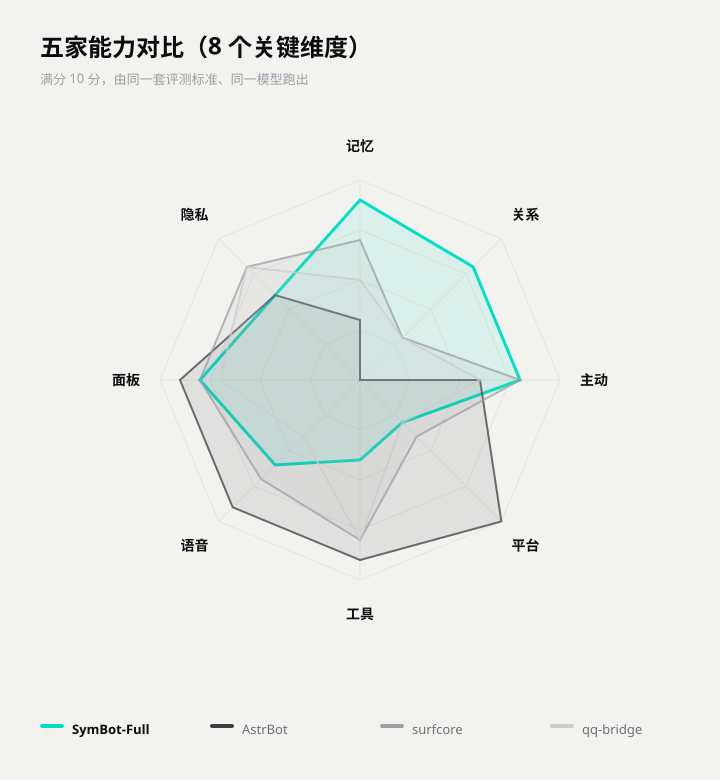
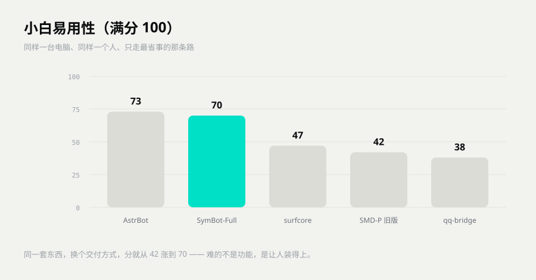

# 和别的机器人比

> 这篇给要做横向对比、准备挑一个长期用的人看。
> 不吹，也不点名。看完你能自己出题去比，而不是听我一面之词。

## 先分成四类

「聊天机器人」这个词太笼统。按「它靠什么活着」分，市面上的东西基本落在四类里。名字不重要，形态才重要。

| 代号 | 形态 | 靠什么活着 | 强在哪 | 短在哪 |
|---|---|---|---|---|
| A | 插件式聊天框架 | 事件路由，功能靠堆插件 | 接的平台多，想加什么加什么 | 功能是散的，记忆要自己拼 |
| B | 角色卡前端 | 人设写进卡，上下文塞提示词 | 上手快，形象立得住 | 聊久了掉设定，关系不会变 |
| C | Agent 工作流 | 节点编排，工具调用 | 能把活干完 | 没有长期关系，换会话就断 |
| D | 知识库问答 | 文档切块再检索 | 答得准，有出处 | 只答文档里有的，不会自己长 |

这四类各有各的活法，没有高下。先想清楚你要的是「工具」还是「伴」，比什么都省事。

## SymBot 属于哪一种

四类都不是。

它是一台单机常驻的数字生命运行时。记忆、关系、人格、作息、主动开口，五样东西共用一本账。聊天通道是可换的外挂，工具是顺手带的。

打个比方。A、C、D 像公司里的同事，你叫他才来，下班就走。SymBot 像住你家里的那个人，你不在她也在，会困、会记得你上周说过什么、会自己找话说。

## 比得清楚的几个维度

只留能验证的。比不清的、只能靠参数堆的，这里不写。

| 维度 | A 插件框架 | B 角色卡 | C Agent | D 知识库 | SymBot |
|---|---|---|---|---|---|
| 长期记忆 | 插件给什么算什么 | 塞上下文，聊久了就掉 | 会话级，换会话就断 | 只记得文档里有的 | 原生：会淡忘、能钉住、按人分开 |
| 关系会不会变 | 得自己写 | 没有 | 没有 | 没有 | 有：数值和阶段都在，恋人只有一个 |
| 有没有自己的时间 | 弱 | 弱 | 没有 | 没有 | 有：作息、日程、日记，半夜会困 |
| 数据在哪 | 看你怎么部署 | 本地 | 多在云端 | 多在云端 | 本地一个目录，整目录搬走 |
| 怎么扩展 | 插件市场 | 换卡、改前端脚本 | 编节点 | 接文档 | 丢个模块目录，重启就生效 |
| 装起来多重 | 中 | 轻 | 中到重 | 重 | 一个安装包，不用管理员 |
| 能不能多机 | 能 | 不能 | 能 | 能 | 不能，故意的 |

表里没有「谁更聪明」。模型是外接的，换一家就换一种聪明，这条比了没意义。

## 怎么比才算公平

别比「谁功能多」。比同一件事，放几天还成不成立。四组题够用了，都能复跑。

### 题一：记忆一致性，跑七天

1. 第一天说 20 条事实，里面掺 3 条互相矛盾的。
2. 第三、五、七天，各问 10 条。
3. 只记三件事：还记不记得、矛盾的几条怎么处理、已经过时的信息还在不在。

### 题二：关系连续性

连着五天用同一个话题往前推，中间插一次冲突、一次道歉。

看三件事：阶段是不是只往前走、不来回横跳；吵完会不会退回上一档；恋人是不是只有一个。

### 题三：主动性，静置十二小时

关掉所有提醒，放她一个人待半天，记她主动开口的次数和时间点。

看三件事：半夜闭不闭嘴；一天的配额守没守住；每次开口能不能说出依据。

### 题四：迁移性

把整个数据目录拷到另一台机器，或者换个模型，接着聊同一段。

看三件事：人设漂没漂；记忆还剩多少；关系数值变没变。

## 五家实测结果

我们按上面四组题跑了五家，图上标的就是真名。样本不大，结论只当参考，不当权威。

一句话结论：记忆、关系、主动这三项，SymBot 高出一截。工具、平台、面板这几项，它不占优，图上能直接看出来。

一句话结论：装起来这一关，SymBot 拿 70 分，排第二，离第一差 3 分。一个安装包、不要管理员；扣分主要扣在接 QQ 那一步。

打分口径在 [评测标准](评测/评测标准-v1.0.md)，完整两份报告在 [五机器人对比报告](评测/五机器人对比报告.md) 和 [五家小白易用性评测](评测/五家小白易用性评测.md)。过程不在这篇里铺，想复跑照着三份文件来。

## 我们主动放弃的东西

五条，每条都说清为什么。看着像缺点，其实是选择。

1. **不做插件市场。** 模块只留够用的扩展点。真做市场，就得背兼容、背审核、背安全，最后变成一个框架，不再是一个人。
2. **不做多机分布式。** 单进程单实例，记忆就在本地一个目录。换来的是两边不会打架，搬家只拷一个文件夹。
3. **记忆内核不开源。** 只给接口和看得见的能力。内核是这项目的根，公开了就没法保证别人改完还能跑。
4. **不做群管理。** 群聊只做语境、印象、迎新。踢人、禁言、风控一概不碰，那是管理员的事。
5. **优先像人，不优先能干活。** 工具是顺手带的。要比谁更能干活，Agent 平台赢，这个我们认。

## 自测数字

下面四套是自己跟自己比的回归，不是横向跑分，别混着用。数字取最近一次全量跑的结果，版本不同会有出入。

| 套件 | 结果 | 管什么 |
|---|---|---|
| 边界回归 | 35/35 | 刁钻输入没把老行为弄坏 |
| 主链路冒烟 | 387 通过，0 失败 | 从收到消息到回出去，整条通 |
| 全量自检 | 149/149，路由 129/129 | 每条路由、每个路径都在 |
| 面板自检 | 145 通过，0 失败 | 五个页面能开，按钮有反应 |

数字只说明一件事：这次改动没弄坏上次的东西。它不代表比谁强。

---

## 下一步

- 想知道她凭什么记得住 → 看 [记忆怎么工作](记忆怎么工作.md)
- 想先装一个试试 → 看 [上手指南](../上手指南.md)
- 想接 QQ、装语音 → 看 [插件与第三方](插件与第三方.md)
- 想自己加功能 → 看 [自己写模块](自己写模块.md)
