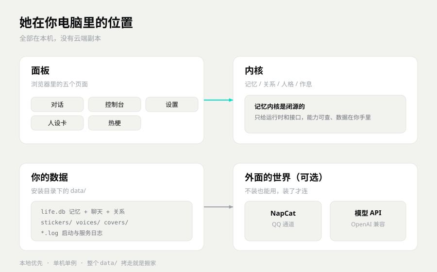

# 安装与依赖

> 这篇给两种人：想手动装的人，和想搞清楚每个依赖是干嘛的人。
> 只想快点用上，看 [上手指南](../上手指南.md) 就行。

---

## 三种装法，先挑一种

| 装法 | 适合谁 | 要准备什么 | 大概多久 |
|---|---|---|---|
| 双击安装包 | 大多数人 | 无，下载就行 | 5–10 分钟 |
| 一键脚本 | 想自己控制安装位置的人 | 一个解压好的目录 | 10–20 分钟 |
| 源码 | 开发者，想改代码 | Git、Python 3.11–3.14 | 20 分钟起 |

### 双击安装包

最省事，不用装 Python，不用碰命令行。

1. 下载 `SymBot-Core-Setup-0.2-P.exe`（137 MB）或 `SymBot-Standard-Setup-0.2-P.exe`（223 MB）。
2. 双击，一路「下一步」。
3. 默认装到 `%LOCALAPPDATA%\Programs\symbot-core`，Standard 是 `symbot-standard`。
4. 桌面出现「SymBot 衡忆」，双击打开。

安装包是自签名证书。Windows 会提示「未知发布者」，这是正常的，不是病毒。确认来源是 GitHub Release 再放行。

### 一键脚本

拿到的是压缩包，里面有两个 bat。

1. 解压到英文路径，路径里别有空格和引号。
2. 双击 `安装依赖.bat`。它会自己建虚拟环境、装依赖，大概 1–3 分钟。
3. 双击 `一键启动.bat`。浏览器会自己打开面板。

第一次启动会在 `data/` 下建库，不会动你已有的东西。

### 源码

适合要改代码、要写自己模块的人。

1. `git clone` 仓库。
2. 建虚拟环境，装 `requirements.txt`。
3. 跑 `python -m app.cli serve`。
4. 浏览器打开 `http://127.0.0.1:8787/`。

具体命令在下面的「手动安装步骤」。

---

## 系统要求

| 项目 | 要求 | 说明 |
|---|---|---|
| 系统 | Windows 10 / 11，64 位 | 桌面壳只有 Windows 版；macOS、Linux 只能跑内核 |
| CPU | 近五年的 x86-64 | 老机器也能跑，就是慢一点 |
| 内存 | 4 GB 能跑，8 GB 更舒服 | 面板是个浏览器窗口，会吃一点内存 |
| Python | 3.11 – 3.14 | 源码要自己装；一键脚本会自己准备；双击安装包不用管 |
| 磁盘 | 程序几百 MB，数据另算 | 留 2 GB 空位比较稳；聊天记录、语音会一直长 |
| 显卡 | **不需要** | 聊天、记忆、面板都在 CPU 上。语音合成才可能用显卡 |
| 网络 | 可选 | mock 模式完全离线；接模型、接 QQ 才要网 |
| 端口 | 8787 | 被占就换一个，启动时加 `--port` |

Python 版本没把握就装 3.11。3.12 到 3.14 也支持，但有些可选包的预编译轮子出得晚，装起来会慢。

---

## 运行依赖清单

全是公开的开源库，用 pip 装，源码不会拷进仓库，不影响本项目许可。

记忆内核随程序分发，不开源，不在下面的清单里。它不需要你单独装什么。



### 必装

| 库 | 干什么 |
|---|---|
| fastapi | 提供面板和内核对外的 HTTP 接口 |
| uvicorn | 跑 FastAPI 的服务器 |
| httpx | 内核往外发请求，比如调模型、连 NapCat |
| pydantic | 校验配置和接口数据，填错了会直接报出来 |
| PyYAML | 读人设卡和配置文件 |
| tzdata | 时区数据，让她知道现在几点 |

### 可选，用到才装

| 库 | 干什么 |
|---|---|
| numpy | 数值计算，语音和图片相关的功能会用到 |
| Pillow | 处理图标、表情和图片 |
| pypdf | 读 PDF 资料 |
| reportlab | 导出 PDF |
| tiktoken | 估算文本长度，控制一次发多少给模型 |
| yt-dlp | 下载音轨，点歌和翻唱要用 |
| demucs | 人声分离，翻唱要用 |
| websockets | 实时推送，部分功能要用 |
| python-dotenv | 从 `.env` 文件读环境变量 |

### 不随包分发的外部件

这些不是 pip 依赖，缺了只影响对应功能。

| 外部件 | 干什么 | 不装会怎样 |
|---|---|---|
| NapCat | 把 QQ 接成 OneBot v11 | 面板照常用，QQ 里没有她 |
| 本地语音服务 | 合成语音条 | 能聊天，没有语音条 |
| ffmpeg | 转码、混音 | 翻唱和点歌跑不起来 |
| RVC 音色模型 | 换声 | 翻唱少一步 |
| 表情包素材 | 发表情 | 只是没图发 |

---

## 环境变量

临时改配置用环境变量，比改文件快。变量名都以 `SYMEM_` 开头。

| 变量 | 作用 | 例子 |
|---|---|---|
| `SYMEM_ENV` | 运行环境，`test` 或 `prod` | `test` |
| `SYMEM_DATA` | 数据根目录，程序在它下面建 `data/` | `D:\SymBotData` |
| `SYMEM_DB` | 直接指定数据库文件 | `D:\SymBotData\data\life.db` |
| `SYMEM_PORT` | 面板端口 | `8787` |
| `SYMEM_BASE_URL` | 模型接口地址 | `https://api.deepseek.com/v1` |
| `SYMEM_API_KEY` | 模型密钥 | `sk-xxx` |
| `SYMEM_MODEL` | 模型名 | `deepseek-chat` |
| `SYMEM_MOCK` | 设成 `1` 强制离线 mock | `1` |
| `SYMEM_CONSOLE_TOKEN` | 面板访问口令，绑非本机地址时必填 | 一串随机字符 |
| `SYMEM_ONEBOT_ENABLED` | QQ 通道开关 | `0` 或 `1` |

PowerShell 里这样设，只对当前窗口有效：

```powershell
$env:SYMEM_ENV = "prod"
$env:SYMEM_API_KEY = "sk-xxx"
.\.venv\Scripts\python.exe -m app.cli serve --port 8787
```

关掉窗口就没了。想长期生效，写进 `config.local.yaml`。那个文件是本机私有配置，不进仓库。

> 面板默认只绑 `127.0.0.1`。要绑到局域网地址，必须同时设 `SYMEM_CONSOLE_TOKEN`，否则启动会被拦下来。

---

## test 和 prod 有什么区别

发布默认是 `test`。这样 clone 下来直接跑，不会碰你已有的库，也不会替你往 QQ 里发东西。

| | test（默认） | prod（正式） |
|---|---|---|
| 数据库 | `data/test-life.db` | `data/life.db` |
| QQ / OneBot | 全关 | 按设置里的开关 |
| 语音合成 | 关 | 按开关 |
| 热梗抓取 | 关 | 按开关 |
| 适合 | 试用、演示、开发 | 日常使用 |
| 会不会动你的数据 | 不会 | 会 |

切换有两种办法。

改 `config.yaml`：

```yaml
environment: test
# environment: prod
```

或者启动前设环境变量：

```powershell
$env:SYMEM_ENV = "prod"
```

两个库是分开的。test 里聊的内容不会自动进 prod。第一次切 prod，库是空的，程序会自己把库准备好，不用手动初始化。

日常用建议切 prod，不然 QQ 通道一直关着。只是试试，就留在 test。

---

## 手动安装步骤

### Windows

```powershell
git clone https://github.com/Niko-126/SymBot SymBot
cd SymBot

py -3.11 -m venv .venv
.\.venv\Scripts\python.exe -m pip install -U pip
.\.venv\Scripts\python.exe -m pip install -r requirements.txt

Copy-Item config.example.yaml config.local.yaml
.\.venv\Scripts\python.exe -m app.cli serve --port 8787
```

然后打开 <http://127.0.0.1:8787/>。

### macOS / Linux

```bash
git clone https://github.com/Niko-126/SymBot SymBot
cd SymBot

python3.11 -m venv .venv
.venv/bin/python -m pip install -U pip
.venv/bin/python -m pip install -r requirements.txt

cp config.example.yaml config.local.yaml
.venv/bin/python -m app.cli serve --port 8787
```

内核能跑，桌面壳没有。用浏览器开面板，效果一样。

装完想换个数据目录，设 `SYMEM_DATA` 再启动。想换端口，改 `--port`。

---

## 装完自检清单

- [ ] 浏览器能打开 `http://127.0.0.1:8787/`
- [ ] 右上角状态灯是绿的
- [ ] 发一句「在吗」，她有回复。mock 模式回固定句子也算通
- [ ] 控制台 → 服务抽屉，能看到记忆内核的 pid 和端口
- [ ] 安装目录下生成了 `data/`，里面有 `life.db`
- [ ] 关掉程序再打开，刚才的聊天还在
- [ ] 填了模型 Key 的话，右上角从 `mock` 变成模型名
- [ ] 换一个端口启动，也能打开。这一步验证你会处理端口冲突

前六项过了，安装就是成功的。后两项是加分项。

---

## 常见安装错误对照表

| 报错 / 现象 | 多半是什么 | 怎么办 |
|---|---|---|
| `'python' 不是内部或外部命令` | Python 没装，或者没进 PATH | 装 3.11，勾上 Add Python to PATH；或者改用 `py -3.11` |
| `No module named app` | 不在仓库根目录跑 | `cd` 到有 `app` 文件夹的那一层 |
| `No module named fastapi` | 依赖装到了别的 Python 里 | 用 `.venv\Scripts\python.exe -m pip install -r requirements.txt` |
| pip 下载卡住或超时 | 网络 | 加国内镜像：`-i https://pypi.tuna.tsinghua.edu.cn/simple` |
| `port 8787 is already in use` | 端口被占 | 换 `--port 8788`，或者结束占用端口的进程 |
| 面板 403，或者要口令 | 绑到了非本机地址 | 设 `SYMEM_CONSOLE_TOKEN`，或者绑回 `127.0.0.1` |
| 页面中文乱码 | 编码不对 | 设 `PYTHONUTF8=1`，或者在 Windows 里开 UTF-8 |
| 启动就退出 | 配置写错，或者端口冲突 | 看 `data/` 下日志的最后几十行 |
| 双击 bat 一闪而过 | 依赖没装完，或者路径有空格 | 解压到英文无空格路径，先跑 `安装依赖.bat` |
| 装完没有桌面图标 | 安装被拦，或者没勾图标 | 重跑安装包；开始菜单搜 SymBot |
| QQ 一直连不上 | 环境还是 test | 按上一节切到 prod |

---

## 下一步

- 装好了，想快点聊上 → 看 [上手指南](../上手指南.md)
- 遇到具体毛病 → 看 [常见问题](../常见问题.md)
- 想接 NapCat、语音、翻唱 → 看 [插件与第三方](插件与第三方.md)
