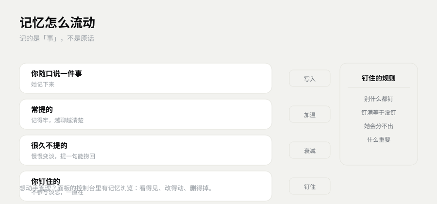
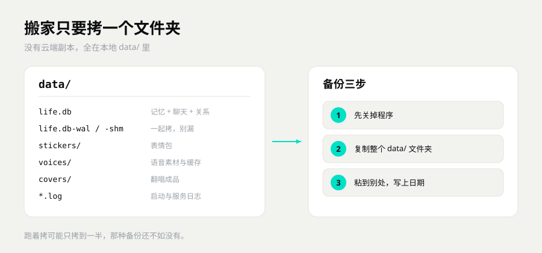

# 记忆怎么工作

Σ 镜衡万象 · Symvolve

> 这篇讲她记得住什么、会忘什么。
> 也讲你怎么看、怎么删、怎么备份。
> 想知道「她到底记不记得我」的人，看这一篇就够。

## 她记得住什么

她不是把聊天记录整段背下来。那样记住的是字数，不是事。

| 你说过的 | 她留下的 |
|---|---|
| 工作、作息、身体、怕什么 | 关于你的事实 |
| 起的外号、约好的事、吵过的架 | 你们之间的梗 |
| 你几点出现、爱用什么语气、什么时候不想说话 | 你的习惯 |

记的是「事」，不是原话。
所以换个说法问，她照样能接上。
她不会一字不差地复述你三天前那句话。那不叫记性好，那叫录音。

**想让她记住，最直接的办法是说出来。**
「我下周要考试」「我不吃香菜」「这件事对我很重要」。
带具体信息的句子，比「你懂我吧」有用得多。

## 她分得清谁是谁

同一个群里，A 说过的话不会算到 B 头上。
私聊和群聊也分着算。
她在群里对你的印象，不会直接变成私下的交情。

- **群聊里，她按人记事。** 谁说的，记在谁名下。
- **私聊里，只有你们两个人。** 这边的语气、称呼、亲密程度，跟群里不一样。
- **同一个人可以有两套相处方式。** 群里客气，私聊黏人，这不矛盾。

所以别担心「我在群里随口一句，她拿去当把柄」。
她记得住话是谁说的。

## 会淡忘，但不是突然消失

常提的事，记得牢。
很久不提的，会慢慢变淡。

变淡的样子不是「某天醒来全忘了」。
是那种「好像有这么回事，但细节想不起来」。
你再提一句，她还能捞回来一点。

这不是 bug。
什么都记得的人，聊起天来很累。
她也不会因为忘了一个细节，就把你整个人忘掉。

图里那条线：进来的事留下，常用的越用越亮，久不用的往边上退，被你重新提起的又亮回来。

## 重要的能钉住

有的事不能淡。你自己说一句就行：

- 「这个别忘了。」
- 「记住，我对花生过敏。」
- 「这条很重要，别弄丢。」

这类话一说，这条就会被钉住。
钉住的不参与淡忘，一直都在。

面板里也能看出来。
控制台 → 选好友 → 记忆 → 查看记忆，被钉住的条目后面会标「置顶」。
钉住这个动作，目前靠一句话。面板负责显示哪条被钉了。

**别什么都钉。**
钉满了，等于没有重点。
真正要钉的，是「忘了会出事」的那几条：过敏、重要日子、明确的约定。

## 能看、能改、能删

控制台 → 左边选好友 → 记忆。

- **能看。** 条数、分类、每条的正文。被钉住的会标出来。
- **能删。** 单条删；也能一次清空这个人的全部记忆。
- **能改。** 面板没有逐条编辑框。记错了有两个办法：当面纠正她，让她把新的记下来；或者删掉旧的，重新说一遍。

删之前想清楚，四种操作清的东西不一样：

| 操作 | 会清掉什么 |
|---|---|
| 删除一条 | 就这一条 |
| 清空这个人的记忆 | 她关于这个人的全部记忆，关系和印象还在 |
| 从记忆里消失 | 关系、记忆、印象、私密记录、聊天原文，一起清，反感归零 |
| 删除好友 | 这个人的对话和记忆一起清 |

这四样都没有回收站。
删了就真没了。

## 数据在哪

都在安装目录下的 `data/` 里。

- `life.db`：记忆和对话。
- `stickers/`、`voices/`、`covers/`：表情包、语音、封面。
- 日志：出问题时先看这里。

没有云端副本。
她只住在这一台电脑上。

备份只要三步：

1. 完全退出程序。托盘里也退掉，别只关窗口。
2. 复制整个 `data/` 到别的地方。U 盘、移动硬盘、网盘都行。
3. 顺手在文件夹名里加上日期，一眼就知道是哪一份。

跑着程序拷，可能只拷到一半。
那种备份，真出事的时候还不如没有。
升级、换机器、重装之前，先备份，再动手。

## 坏了怎么办

发邮件到 **mendastudio@163.com**，标题写「复活小鱼」。
正文附三样：

1. `data/` 的备份，或者压缩包。
2. 大概什么时候、做了什么。比如「升级到新版后打不开」「手滑删了 data 里的文件」。
3. 你想恢复到什么程度：最近一次就行，还是某一天，还是能打开就好。

能捞回多少，看备份完整不完整。
不保证全部回来。

所以别手改 `life.db`。
记忆内核不开源，改坏了没法用常规办法修。

## 为什么不开源

记忆内核不开源。
能力就是上面这些，边界也是上面这些。

你得知道代价：出了问题，只能靠备份和作者，没有社区帮你改代码。
另外，这套数据只服务一台机器。
想两台电脑同时用一份记忆，现在做不到。拷贝可以，同步不行。

这套内核已经独立立项成 Symvolve Memory，方向跟数字生命不一样，所以没并进这个仓库开源。
你手上这套，是它的精简严格版：能力收了收，边界更硬。

## 下一步

- 想知道她怎么看你、怎么走到恋人 → 看 [关系怎么长](关系怎么长.md)
- 想改她的性格、称呼、禁区 → 看 [人设怎么改](人设怎么改.md)
- 刚装好，还没跑起来 → 看 [安装与依赖](安装与依赖.md)
- 数据已经出问题了 → 直接发邮件，标题「复活小鱼」
