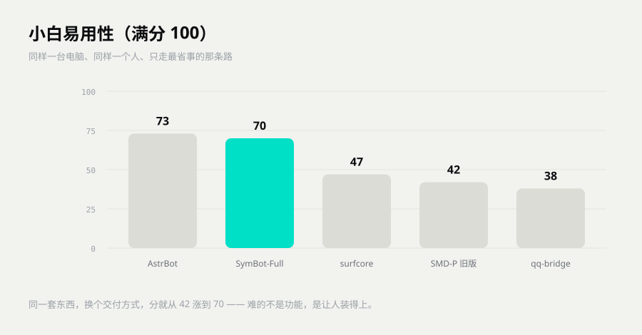

# 五家小白易用性评测（2026-11-03）

> 这篇只回答一个问题：**一个不写代码的人，能不能自己把它跑起来？**
> 「它有多强」的答案在 [五机器人对比报告](五机器人对比报告.md)，两份不要混着看。

---

## 一、怎么测的

找一个人，让他从零开始装，只走**最省事的那条路**。

| 规矩 | 说明 |
|---|---|
| 只走最省事的 | 有安装包就不试源码，有一键脚本就不试手动 |
| 装别人的软件也算一步 | 装 Node、装运行时、扫码登录，都算步数 |
| 只算到「发出第一条消息」 | 想接 QQ 的额外步骤单独记 |
| 按「完全不会电脑的人」估时间 | 不按开发者估 |
| 卡点必须写真名 | 尤其是**静默失败**——界面正常、不报错，但实际不通 |

**静默失败是小白杀手。** 它比报错可怕十倍：报错的人会去搜，不报错的人只会以为「这软件就这样」。

---

## 二、总分

| 排名 | 项目 | 总分 /100 | 步骤 | 要敲命令 | 首次跑通 |
|---|---|---|---|---|---|
| 1 | **AstrBot** | **73** | 7 步 | 1 步 | 约 20 分钟 |
| 2 | **SymBot（全量版）** | **70** | 5 步 | **0 步** | 约 25 分钟 |
| 3 | surfcore | 47 | 12 步 | 0 步（有安装包） | 约 90 分钟 |
| 4 | SMD-P（SymBot 前身） | 42 | 12 步 | 4 步 | 约 180 分钟 |
| 5 | qq-bridge | 38 | 13 步 | 6 步 | 约 75 分钟 |

> 这轮跑的是 SymBot 0.1.0 全量版（还是「解压 + 双击两个 bat」的形态）。
> **0.2-P 改成了真正的安装包**：双击 → 下一步 → 打开就能用，不用装 Python，不用敲命令。
> 所以表里 70 分是下限，不是现在的成绩。

---

## 三、10 个维度

| 维度 | AstrBot | **SymBot** | surfcore | SMD-P | qq-bridge |
|---|---|---|---|---|---|
| 安装方式 | 8 | 7 | 4 | 3 | 4 |
| 前置依赖 | 7 | 4 | 2 | 4 | 2 |
| 步骤数量 | 5 | **7** | 3 | 2 | 1 |
| 图形界面 | **9** | 7 | 6 | 6 | 5 |
| 配置难度 | 8 | 8 | 5 | 6 | 2 |
| 默认可用 | 4 | **7** | 5 | 3 | 3 |
| 出错可诊断 | 8 | 8 | 6 | 7 | 6 |
| 文档友好 | 9 | 7 | 7 | 4 | 6 |
| 恢复与升级 | 8 | 8 | 6 | 5 | 6 |
| 首次耗时 | 7 | 7 | 3 | 2 | 3 |
| **合计** | **73** | **70** | **47** | **42** | **38** |

### 三个关键差异

**「默认可用」：7 分对 4 分。** SymBot 不填 Key 也能开，面板、记忆、关系、日程全能玩，只是回答从本地语料里挑——用户能立刻感知到「这东西是活的」。AstrBot 不填 Key 就是一个哑巴，界面上也不提示你去哪申请。

**「安装方式」：7 分对 3 分。** 这是 42 → 70 的主要原因。同一个产品，从「自己装 Python、建虚拟环境、敲一行命令」换成「双击安装包」，分数直接涨了 28。

**「步骤数量」：5 步对 12 步。** 差的那 7 步全在「装别人的软件」上：运行时、宿主程序、QQ 框架，版本还互相咬。

---

## 四、五家的真实卡点

### AstrBot · 73 分

**能自己搞定。** 官方桌面客户端，双击装完就有能点的面板，不用碰黑窗口。

**卡在两处：**
1. 不填 API Key 就是哑巴，默认一个模型都没配，你打字它不理你，也没有大红提示教你去哪申请。
2. 想进 QQ 群要跨一道坎：要么去 QQ 开放平台申请机器人（要审核），要么装 NapCat 手工配 `ws://` 地址。IP、端口、token 错一个就连不上，报错只有一句「适配器已被关闭」。

**结论**：手上有 Key、只在自己电脑上聊，10–30 分钟能用，体验是五家里最好那档。要进 QQ 群，晚上得再折腾 1–2 小时。

### SymBot（全量版）· 70 分

**五个里唯一一个「不会电脑的人照着双击就能跑起来」的。**

解压到英文路径 → 双击「安装依赖」→ 双击「一键启动」→ 浏览器自己开 → 发第一句。零命令，有面板，有中文文档。

**三处会咬人：**
1. 语音按文档该自动起，其实没起（文档写错）。
2. 语音合成挂了不吭声，静默降级成纯文字。
3. 点歌翻唱里有一处写死的本地路径，失败原因还统一说成「音太高」——用户永远修不好。

**结论**：只想聊天，它是最省事的。想让它出声、唱歌、上 QQ，每个功能都埋着一颗「必须看文档才躲得开」的雷。

> 这三条在 0.2-P 里已经改了：安装包自带一切、语音失败会提示原因、路径改成配置项。

### surfcore · 47 分

**能，但要先过三道门，过门比用软件更费劲。**

1. **先装三个别人的软件**：Node、宿主程序、SnowLuma。第三个要从 Releases 下包、解压到没中文的路径、扫码登录、进设置抄端口——这一步劝退一半人。
2. **安装动作本身**：最省事是别人发你一个 zip，双击 `2-安装.bat`，等 3–10 分钟，退出重开两次，再点「一键安装（全部）」。这段做得漂亮，纯点鼠标、有进度条、有自检。**但仓库里根本没这个 zip**，自己下仓库就得开命令行粘命令。
3. **装完她不理你**：白名单默认是空的，空 = 谁都不放行（不是全放行）。用户 @ 一句没反应，大概率会判定失败删掉重装，正确答案只是回设置里勾一个群。

**结论**：有人把安装包和一个会看日志的人一起递到你手上，就能用；纯靠自己从零到群里说上第一句话，45 分钟到 2 小时。

### SMD-P · 42 分

SymBot 的前身。**它就是那个「42 分」。**

双击鲸鱼图标程序确实会自己起内核、自己开浏览器，3 秒就绪，出错还会弹窗告诉你日志在哪。但「双击」之前有四道坎没人告诉他：装 Python、建虚拟环境、装依赖、敲一行命令把图标生成出来。而且全仓文档里关于「这个图标怎么来的」一个字都没有。

**两个要命的坑：**
1. 不填 API Key 也能开，但她是 mock，答非所问，用户会以为「这 AI 就这水平」。
2. QQ 那条线端口写错是完全静默的——零报错、零消息，而文档还教人「端口冲突就换个号」，等于亲手把人推进坑。

**结论**：这一版她能住进你的电脑，但还住不进小白的 QQ。

### qq-bridge · 38 分

**它不是小白产品，是开发者的自用桥。**

仓库里没有一个安装包，最省事的官方路线是「命令行装三样 + 手改一个 279 行 JSON + 双击 start」——13 步里 6 步要敲命令。QQ 那半边（下载、扫码、开双端口、双 token）桥接完全不代劳。

**三个静默失败把它按在地上：**
1. 没装 Node 时，启动脚本每 5 秒无限重启刷屏。
2. 版本漂移时，QQ 上彻底没反应。
3. 白名单是空的 = 成功启动但一条不回。

三种情况都没有一句「你该改哪里」。

**它做对的地方**：重启脚本会真的把旧实例杀干净（还为此写了事故注释），日志和告警是中文的，白名单提醒直接告诉你填哪里。

**结论**：会一点命令行、愿意花一两个小时的人能跑起来；完全不会电脑的人，多半卡在「窗口一直刷红字」那步。

---

## 五、一张表看清「难在哪」

| 项目 | 最难的一步 | 会不会报错 |
|---|---|---|
| AstrBot | 接 QQ 要申请或配地址 | 会（但看不懂） |
| **SymBot** | 几乎没有，装完就用 | 会（中文） |
| surfcore | 白名单默认空 = 谁都不理 | **不会**（静默） |
| SMD-P | 生成的图标没人告诉你怎么做 | 部分 |
| qq-bridge | 手改 279 行 JSON | **不会**（静默） |

---

## 六、结论

**「装得上的」和「厉害的」经常不是同一个。**

- 想省事：AstrBot 和 SymBot 都能 30 分钟内说上话。
- 想进 QQ 群：五家都要先装一个第三方框架，没有例外。
- 想完全零命令：只有 SymBot 的安装包形态做到了。

所以先问自己一个问题：**你是想「今天就用上」，还是想「用得久」？**

想今天就用上，看这份报告。
想用得久，看 [五机器人对比报告](五机器人对比报告.md)。

---

## 下一步

- 想看能力对比 → [五机器人对比报告](五机器人对比报告.md)
- 想知道怎么复跑 → [评测标准 v1.0](评测标准-v1.0.md)
- 想现在就装 → [上手指南](../../上手指南.md)
