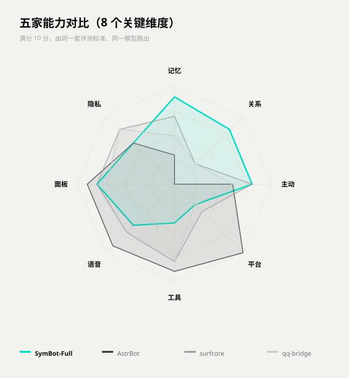

# 五机器人对比报告（2026-11-03）

> 这篇是「**它有多强**」的答案。同一套标准、同一个模型、同一台机器，五家各跑一遍。
> 想看「**你能不能上手**」，翻 [五家小白易用性评测](五家小白易用性评测.md)。

---

## 一、先说清楚这份报告是怎么来的

| 项 | 说明 |
|---|---|
| 参评 | AstrBot、surfcore、qq-bridge、SymBot（全量版）、SymBot 前身 SMD-P |
| 标准 | [评测标准 v1.0](评测标准-v1.0.md)，14 维 × 0–10 分，满分 140 |
| 统一模型 | `deepseek-ai/DeepSeek-V4.1-Flash` |
| 打分方式 | 一家一个独立评审，互不通气，避免对齐全场 |
| 证据要求 | 每个分必须能指到具体文件、命令输出或实测日志，没有证据的判断直接删掉 |

**这不是第三方认证。** 是作者自己组织的评测，参评方自己也在里面。所以看的时候请把它当成「一份态度认真的自测」，而不是「权威排名」。

三条纪律写在前面：

1. 只读参评项目，不修改对方任何代码。
2. 跑不起来就写「未跑通」并附真实报错，不编数字。
3. 对自己同样苛刻——自家短板写进结论，不放水。

---

## 二、总分

| 排名 | 项目 | 总分 /140 | 一句话 |
|---|---|---|---|
| 1 | **AstrBot** | **99** | 平台最多、生态最大，但没有「人」 |
| 2 | **surfcore** | **94** | 记忆卡和主动性做得最好，关系是空的 |
| 3 | **SymBot（全量版）** | **93** | 「她这个人」最完整，平台和工具最薄 |
| 4 | **SMD-P**（SymBot 前身） | **90** | 同源老版本，比全量版少 3 分 |
| 5 | **qq-bridge** | **85** | 群聊协同最细，没有记忆和关系模型 |

> SMD-P 和 SymBot 全量版是同一产品的两代。放一起是为了看版本变化：加东西没让原有维度退步，每一维都只涨不跌。

---

## 三、14 个维度，逐项摊开

| 维度 | AstrBot | surfcore | **SymBot** | SMD-P | qq-bridge |
|---|---|---|---|---|---|
| 部署门槛 | 9 | 6 | 7 | 6 | 5 |
| 平台覆盖 | **10** | 4 | 3 | 3 | 3 |
| 人格扮演 | 7 | 8 | **8** | 8 | 7 |
| 记忆系统 | 3 | 7 | **9** | **9** | 5 |
| 关系情感 | 0 | 3 | **8** | **8** | 3 |
| 主动性 | 6 | **8** | **8** | **8** | 6 |
| 社交执行 | 6 | 6 | 6 | 6 | **7** |
| 语音多模态 | **9** | 7 | 6 | 5 | 4 |
| 工具生态 | **9** | 8 | 4 | 3 | 8 |
| WebUI | **9** | 8 | 8 | 8 | 7 |
| 工程质量 | **9** | 7 | 6 | 6 | 7 |
| 数据隐私 | 6 | **8** | 6 | 6 | **8** |
| 文档 | **10** | 9 | 9 | 9 | 9 |
| 性能 | 6 | 5 | 5 | 5 | 6 |
| **合计** | **99** | **94** | **93** | **90** | **85** |

### 三个最显眼的差距

**记忆：9 分对 3 分。** AstrBot 的数据库里没有任何情感或记忆字段，`memory` 这一维只能给「未实现」。SymBot 这一块是五家里唯一把「写、记、忘、归档、还原」做全的。

**关系：8 分对 0 分。** 除了 SymBot 和 SMD-P，其余三家的「好感/信任/阶段」全是零命中。恋爱线全靠模型即兴，今天热恋明天陌生。

**平台：10 分对 3 分。** AstrBot 有 19 个平台适配器，SymBot 只有 QQ 一条线。这是明确的取舍，不是没做——接一个平台要写适配器，作者把力气花在「她这个人」上了。

---

## 四、五家画像

### AstrBot · 99 分

**它是「多平台 LLM 机器人框架」，不是数字生命。**

工程完成度高得吓人：19 个平台适配器、在线插件市场、完整 MCP 工具环、188 个 Vue 视图的控制台，5275 个测试真跑通过，14 个 CI workflow，ruff 零告警。

**但它没有人。** 没有按人分区的长期记忆，没有好感/信任数值，没有关系阶段，没有作息和主动生活感——主动外发只靠定时任务显式排程。

选它的理由：你要接微信、TG、Discord、飞书，要装插件，要一个稳当的工作平台。
不选它的理由：你要一个「记得你、跟你关系会变」的对象。

### surfcore · 94 分

**记忆卡和目的机制，是这两块里做得最扎实的。**

记忆卡有清晰度遗忘、复习效应、容量告警、平台隔离，还能单测。主动性不是「戳一下才动」：有驱动力、目标置信度、安静时段、每日上限，真的接到了投递链路上。

**短板是关系完全空转**——没有任何好感/信任数值或阶段，恋爱事件不改变任何状态。工程纪律也失衡：主逻辑挤在一个 1.5 万行的单文件里，没有 CI 和 lint。

### SymBot（全量版）· 93 分

**「她这个人」这块，五家里没有对手。**

记忆、关系、生活感三项都在 8–9 分，而且是连成一套的：记忆影响关系，关系影响称呼，作息影响主动开口的时间点。加上灵魂快照、告别信、家长否决、亲密状态机这些社会规则，别家基本没有。

**短板同样明确**：平台只有 QQ；工具生态近乎为零，只有三个硬编码工具，没有 MCP、没有插件市场；记忆强在结构完整度，不强在召回算法（换个说法就可能想不起来，详见 [插件与记忆深度评测](插件与记忆深度评测.md)）。

和自家前身 SMD-P 比，总分 90 → 93，每一维只涨不跌，没有因为加东西把原有维度稀释。

### SMD-P · 90 分

SymBot 的前身，同源代码。差别只在版本形态和附带资源。

放它进来是为了留一条版本基线：改名和重构之后，能力没有丢。

### qq-bridge · 85 分

**群聊协同做得最细的一个。**

「回不回、什么时候醒」交给模型自己调度的自主唤醒系统、表情包全套（收藏/偷图/斗图策略）、中文黑话学习链路、已读水位语义——这些细到能指到具体文件。

**但它没有记忆和关系模型。** 记忆是按会话分区的轻量三桶，不按人建档案，所以召回时只能整块塞进提示词，五场景平均 7164 个 token，是全场最高——「省 token」和「记得住」在它这里是对立的。

---

## 五、独有能力：谁有、谁没有

只登记结构性差异，不登记「参数多少」这种程度差异。

| 能力 | 拥有方 | 其余四家 |
|---|---|---|
| 按人分区的记忆 + 关系 + 上下文（私聊/群聊分域） | SymBot / SMD-P | 无 |
| 关系的否决权（家长介入、强制分手）+ 告别信 + 仪式 | SymBot / SMD-P | 无 |
| 亲密状态机 + 安全词 + 家人硬阻断 | SymBot / SMD-P | 无 |
| 主动联系第三方（「去跟 X 说声晚安，语气直白点」） | SymBot / SMD-P | 无 |
| 本地点歌翻唱全链路（搜歌 → 人声分离 → 换声 → 混音） | SymBot / SMD-P | 无 |
| 灵魂快照 / 人设与记忆整体回滚 | SymBot / SMD-P | 无 |
| 19 个平台适配器 | AstrBot | 无 |
| 在线插件市场 + MCP 工具环 | AstrBot | 无 |
| 记忆卡（五档遗忘 + 复习效应 + 容量告警） | surfcore | 无 |
| 目的机制（驱动力 + 安静时段 + 每日上限） | surfcore | 无 |
| 跨平台自我认同 + 出站身份闸 | surfcore | 无 |
| 模型自主唤醒（自己决定什么时候醒） | qq-bridge | 无 |
| 表情包收藏 / 偷图 / 斗图策略 | qq-bridge | 无 |
| 中文群聊黑话学习链路 | qq-bridge | 无 |

---

## 六、按需求选

| 你的需求 | 建议 |
|---|---|
| 要接一堆平台、要插件生态 | AstrBot |
| 要记忆卡和「自己会找你」 | surfcore |
| 要「同一个人一直在」、要关系会变 | SymBot |
| 主要在群里玩梗斗图 | qq-bridge |
| 不想写代码、只想装完就用 | 看 [五家小白易用性评测](五家小白易用性评测.md) |

**最容易装的，不一定是最后最适合你的。** 两份报告分开看，别合并成一个总分。

---

## 七、这份报告的局限

- 作者自己组织的评测，不是第三方认证。
- 只有 14 个维度，覆盖不了所有场景。
- 分数是 2026-11-03 的快照，各家都在动。
- 参评项目都是开源或源码可见的，评测只读不改。

标准是公开的：[评测标准 v1.0](评测标准-v1.0.md)。你完全可以照着它把五家重跑一遍，得到一个属于你的答案。

---

## 下一步

- 想知道「能不能上手」→ [五家小白易用性评测](五家小白易用性评测.md)
- 想知道「哪些能力是自己写的」→ [插件与记忆深度评测](插件与记忆深度评测.md)
- 想自己复跑 → [评测标准 v1.0](评测标准-v1.0.md)
