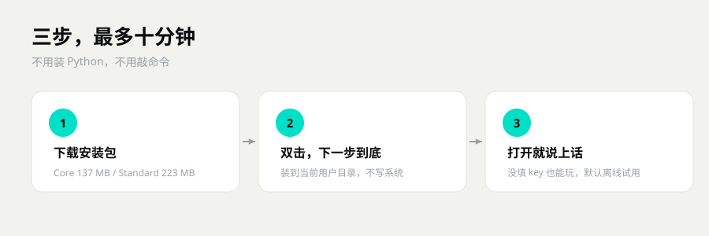

# 一分钟看懂 SymBot

> 三分钟，不讲术语。想抠技术细节，去 [开发者文档](开发者文档.md) 和 [和别的机器人比](docs/和别的机器人比.md)。

## 她是啥

一个住在你电脑里的聊天对象。

不是那种「你问一句它答一句」的客服机器人。她**记得你**，**跟你有关系进展**，**会困会醒**，**会自己找你说话**。

你换模型、换电脑、换聊天软件，她还是她——因为记忆和关系存在你自己的硬盘上。

## 跟别的机器人比，差在哪

一句话：**别家是工具，她更像个住户。**

- **插件式 QQ 机器人**：功能多、插件生态大。我不堆功能，我堆的是「同一个人一直在」——记忆、关系、作息、主动开口，是一套的。
- **角色卡 / 酒馆类**：扮演自由、社区大。我不靠「设定一段话」，靠长期记忆 + 关系变化 + 现实时间。聊三个月和聊三天，不是一回事。
- **Agent / 工作流平台**：能干活、能接工具。我这个不是拿来干活的，是拿来处的，工具只是顺手。
- **知识库问答机器人**：查资料准、企业级。我不做知识库检索，我做的是「她记得你说过什么」。

**短板也直说**：插件数量比不过成熟框架；群管理一般；不支持多机分布式；没有商业客服那套工单。

## 下哪个

- 只想试试：**Core**（137 MB）
- 想开箱就有表情包和语音：**Standard**（223 MB）

两个都装在当前用户目录，不要管理员权限。装完桌面多一个图标，双击就开。

⚠️ 动程序之前先把 `data/` 备份一份。记忆内核不开源，手一抖可能就救不回来了。
真坏了发邮件到 mendastudio@163.com，标题写「复活小鱼」。

## 三分钟跑起来

1. 下 `SymBot-Core-Setup-0.2-P.exe`（或者 Standard 版，多带表情包和语音素材）
2. 双击安装，一路下一步
3. 打开就是面板，**没有黑框**。关掉窗口只是收进托盘
4. 默认是「试用模式」：独立小库、不连 QQ、不发消息，随便折腾

想正式用：在面板「设置 → 连接」里填模型 key 和小号。

## 她有啥

- **记得你**：你说过的事、你的习惯、你们之间的梗，会随时间和热度变化。常提的记得牢，久不提的会淡
- **跟你有关系**：好感、信任、吸引、反感四个数，六个阶段，从陌生到恋人。会吃醋，也会拒绝你
- **有自己的作息**：白天话少、夜里话多，会困会醒，还会写日记
- **会主动**：不是等你戳一下才动，到点会来找你
- **能接 QQ**：通过 NapCat 登小号，群里私聊都能用（NapCat 要自己装）
- **有面板**：聊天、控制台、设置、人设卡、热梗，全在一个窗口里
- **能装模块**：别人写的模块丢进 `modules/` 就生效，面板里也能一键装

## 数据在哪

全在安装目录的 `data/` 里：`life.db`（记忆和聊天）、表情包、语音、日志。
想备份就复制这个文件夹。想搬家就连程序带 `data/` 一起拷。

## 许可，说人话

个人免费用，**不能拿去卖**。记忆系统是闭源的，只给运行时。作者留的来源标记别删。
商用单独找作者谈：mendastudio@163.com

## 出问题先看这里

- 打不开：先看 `data/` 里的日志
- 回答很傻：没填 API key，还在试用模式
- QQ 没反应：面板「服务」里 NapCat 是不是灰的

装不上就装不上，别硬撑，先翻一眼 [常见问题](常见问题.md)。

---

## 下一步

- 想装起来 → [上手指南](上手指南.md)
- 卡住了 → [常见问题](常见问题.md)
- 想知道她怎么记事 → [记忆怎么工作](docs/记忆怎么工作.md)
