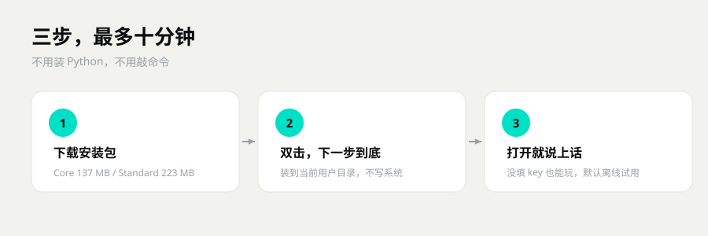
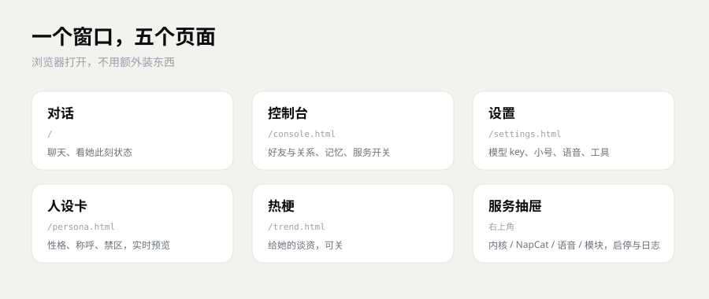
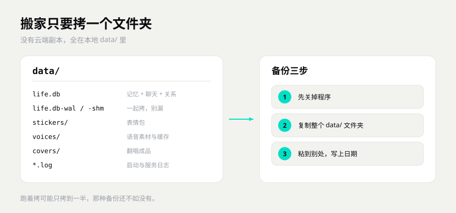

# 上手指南：从下载到跟她说上话

> 这篇解决一件事：把 SymBot 装到你自己的 Windows 电脑上，打开，跟她说上第一句话。
> 顺利的话 10 分钟。接 QQ 再加 10 分钟，语音看你有没有现成的服务。
> 卡住了别硬扛，先翻最后一节「坏了怎么办」，按现象对号入座。

---

## 开始之前，先看看你的电脑

| 项目 | 要求 | 说明 |
|---|---|---|
| 系统 | Windows 10 / 11，64 位 | 桌面程序只有 Windows 版。macOS 和 Linux 能跑内核，但要自己敲命令 |
| 磁盘 | 留 2 GB 空位 | 安装包 137 MB 起，装完占几百 MB。聊天记录、表情、语音会一直长 |
| 显卡 | **不需要** | 聊天、记忆、面板全在 CPU 上跑。只有语音合成可能用显卡，还是可选 |
| 网络 | 装的时候要，之后可选 | 不填模型 Key 也能用，mock 模式完全离线。接模型、接 QQ 才要网 |

一句话：**一台近五年的 Windows 电脑就够，核显笔记本也能跑。**

---

## 第一步：下载哪个

只有两个正式版本，装哪个都能聊天。

| 版本 | 里面有什么 | 安装包大小 | 适合谁 |
|---|---|---|---|
| **Core** | 本体 + 记忆内核 + 面板 + 文档 | **137 MB** | 先试试，想自己攒表情包 |
| **Standard** | Core + 表情包 + 语音素材 | **223 MB** | 想一装好就有表情和语音条 |

**建议：先下 Core。** 想省流量、只想聊天，137 MB 足够了。喜欢了再换 Standard，装的是同一个程序，只差随包带的资源。

> 两个版本建议只装一个。各装一份就是两套 `data/`，聊天记录不互通。

---

## 第二步：安装

1. 双击下载好的 `SymBot-Core-Setup-0.2-P.exe`（Standard 是 `SymBot-Standard-Setup-0.2-P.exe`）。
2. 如果弹出蓝色窗口「Windows 已保护你的电脑」，点「更多信息」，再点「仍要运行」。安装包是自签名证书，没有买商业签名，[常见问题](常见问题.md) 里有详细解释。
3. 一路点「下一步」。安装位置默认是：
   - Core：`%LOCALAPPDATA%\Programs\symbot-core`
   - Standard：`%LOCALAPPDATA%\Programs\symbot-standard`

   建议别改。要改也行，别放 U 盘和网盘同步目录。
4. 装完桌面会多一个「SymBot 衡忆」图标。双击就开，**不会弹黑框**。

整个安装是当前用户级别的，不需要管理员权限，不写系统目录，不装服务。



---

## 第三步：第一次打开，确认这四件事

程序打开后是一个浏览器样子的窗口，这就是面板。

1. **能看到对话页。** 左边是好友列表，中间是聊天，右边是她此刻的想法。
2. **右上角状态灯是绿的。** 鼠标放上去会写「服务在线」。
3. **发一句「在吗」，她有反应。** 没填模型 Key 时她回的是固定句子，这是正常的 mock 模式，不是坏了。
4. **点右上角「控制台」，服务抽屉里能看到「记忆内核」。** 有 pid、端口、运行时长，说明内核活着。



这四件都过了，程序本体就是好的。后面全是可选项，不装也能聊。

---

## 第四步：接一个真模型（可选）

不接也能聊，但回复是从本地语料里挑的，比较死板。接上真模型，她才会真的接话。

1. 打开「设置 → 连接」。
2. 填三项：
   - **接口地址**：OpenAI 兼容的地址，一般以 `/v1` 结尾。
   - **API Key**：你买的或申请的那串 key。
   - **模型名**：接口那边实际叫的名字。
3. 点保存。**不用重启**，面板会自己切过去。
4. 回对话页发一句，看右上角从 `mock` 变成模型名，就是接上了。

常见来源：DeepSeek、硅基流动、OpenAI，或者任何 OpenAI 兼容的网关。地址、Key、模型名都填那一家给的，别混着用。

> Key 只存在你自己电脑上。别把填好 Key 的电脑随便借人。

---

## 第五步：接 QQ（可选，大概 10 分钟）

接上以后，你在 QQ 里也能找到她。

### 5.1 先装 NapCat

NapCat 是第三方项目，不随 SymBot 分发，得你自己装。

1. 去 <https://github.com/NapNeko/NapCatQQ> 的 Release 下 Windows 版。
2. 解压到一个固定的英文目录，比如 `D:\NapCat`。
3. 记住这个目录，下一步要填。

NapCat 要管理员权限，还要跟 QQ 客户端版本对得上。这两件事都是它自己的要求。

### 5.2 回面板填两样

打开「设置 → 连接」：

- **NapCat 安装目录**：刚才解压的那个目录。
- **小号 QQ**：你要登的那个号，建议用小号。

填完保存。

### 5.3 启动，登录

1. 控制台 → 服务抽屉 →「NapCat」，点「启动」。
2. 弹 UAC 就点「是」。
3. 等 10–30 秒，状态灯变绿。
4. 还没登录就点「登录二维码」，用手机 QQ 扫；或者点「快速登录」，复用本机登录记录。

### 5.4 确认上报地址

NapCat 要把消息推到：

```text
http://127.0.0.1:8787/onebot/event
```

面板保存目录时会自动检查并修改，改之前会备份。你要手动改，就去 NapCat 的 WebUI → 网络配置，改完重启 NapCat。

### 5.5 试一句

用**你自己的号**给她发一句。面板能看到消息，QQ 也收到回复，就是通了。

> 默认会自动通过好友申请，不想要就在「设置 → 连接」里关掉。
> 默认不会主动给好友发消息，只回你发过去的。

> 环境如果是 test，QQ 通道是关着的。源码和压缩包版默认就是 test，先在 `config.yaml` 里把 `environment` 改成 `prod`，或者启动前设 `SYMEM_ENV=prod`。

---

## 第六步：语音（可选）

语音要一个外部的本地语音服务，程序本身不带。

1. 先把你自己的语音服务跑起来，默认地址 `http://127.0.0.1:9880`。
2. 「设置 → 声音」填地址。服务要 key 的话，把 key 也填上。
3. 打开「允许语音」，点「试听」。
4. 控制台 → 服务抽屉 →「语音」，能看到模型名和上次合成耗时。

没有语音服务也能正常聊天，只是没有语音条。声音像不像、好不好听，取决于你接的那个服务和模型，不在本体范围内。

---

## 数据在哪，怎么备份

所有东西都在安装目录下的一个 `data\` 文件夹里：

| 里面有什么 | 说明 |
|---|---|
| `life.db` | 聊天、记忆、关系、日程，全在这一个文件里 |
| `stickers\` | 表情包 |
| `voices\` | 语音素材和合成缓存 |
| 日志 | 启动、服务、报错，出问题先看这里 |

**备份就一句话：退出程序，把整个 `data\` 复制走。**

程序开着的时候直接拷 `life.db`，可能拿到的是旧快照。`life.db-wal`、`life.db-shm` 也要一起带，最稳的还是先退出。



搬家同理：新电脑装同一个版本，先启动一次再退出，用旧的 `data\` 覆盖新的，启动就回来了。

> 别手改 `life.db`。记忆内核不开源，改坏了可能救不回来。
> 真坏了发邮件到 **mendastudio@163.com**，标题写「复活小鱼」，附上备份。

---

## 升级

1. 先备份 `data\`。
2. 下载新版本的安装包，直接装，还装到原来的位置。
3. 启动。数据库会自己迁移，只往前，不往回。
4. 跨大版本之前一定备份，方便后悔。

从 Core 换 Standard 是两个不同的安装目录。先把旧 `data\` 备份，装好 Standard 后拷过去，聊天记录才跟得上。

---

## 卸载

1. 退出程序，托盘图标也右键退出。
2. 先把 `data\` 备份到别的地方。
3. Windows「设置 → 应用 → 已安装的应用」，找到 SymBot，点卸载。
4. 想彻底清空，卸载后再删安装目录里剩下的 `data\`（如果还在）。

`data\` 就在安装目录里。有的卸载方式会连它一起清掉，所以先备份再卸载。

---

## 坏了怎么办

| 现象 | 先看哪 | 多半是什么 |
|---|---|---|
| 双击安装包没反应 | 杀毒软件的拦截记录 | 被当成可疑文件拦了，或者包没下完整 |
| 提示「未知发布者」 | 安装包的来源 | 自签名证书，正常现象，确认来源后放行 |
| 打开是空白页 | 地址栏和控制台服务抽屉 | 内核没起来，或者端口被占了 |
| 状态灯不绿 | 服务抽屉 → 记忆内核 | 内核进程挂了，点「重启内核」 |
| 她回得又短又机械 | 右上角是不是 `mock` | 没填 API Key，或者填了没保存 |
| QQ 没反应 | 服务抽屉 → NapCat 的灯 | NapCat 没起、小号没登录、上报地址不对 |
| 语音没声 | 「设置 → 声音」的试听、语音日志 | 语音服务没起，或者地址端口不对 |
| 桌面图标不见了 | 开始菜单搜「SymBot」 | 图标没勾上，从开始菜单打开一次 |

更细的排查在 [常见问题](常见问题.md)。

---

## 下一步

- 遇到具体毛病 → 看 [常见问题](常见问题.md)
- 想知道她怎么记事、怎么忘事 → 看 [记忆怎么工作](docs/记忆怎么工作.md)
- 想手动装、想搞清楚每个依赖 → 看 [安装与依赖](docs/安装与依赖.md)
