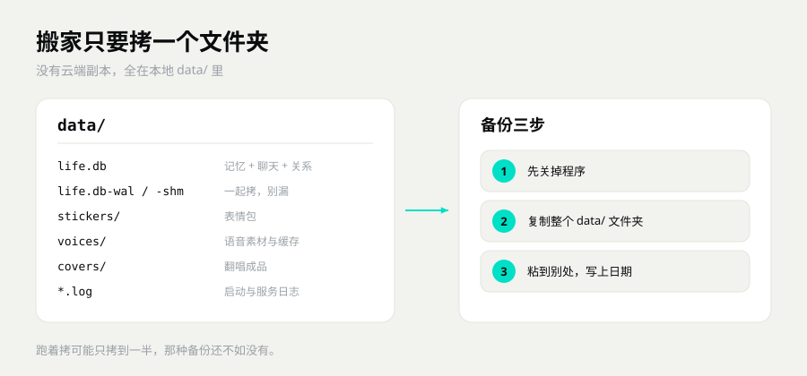

# 常见问题

> 按「你看到什么现象」分组。先找到你那一条，照着做。
> 这里没有的，去 [上手指南](上手指南.md) 最后一节按现象查。

---

## 一、装的时候就不顺

### 双击安装包，没反应，也没报错？

先等 10 秒。安装包要解压，老机器会慢。

还是没反应，看三处：

1. 任务栏有没有 UAC 盾牌在闪，点它。
2. 杀毒软件有没有弹窗，可能被静默拦了。
3. 右键安装包 → 属性，底下有没有「解除锁定」。有就勾上，再双击。

### 杀毒软件报警，说是不认识的文件？

多半是误报。安装包用的是自签名证书，没有向证书机构买商业签名。所以 Windows 会显示「未知发布者」，杀软也可能直接拦。

自签名只说明「这个包带着作者自己的签名」，没有第三方机构担保，不等于安全认证。确认包是从 GitHub Release 下的，大小和发布页写的一致，就基本能排除下错包。

不放心的话，先把安装包传到 VirusTotal 扫一遍，或者删掉重新下一次。

### 装到一半失败了？

多数是目录没权限，或者磁盘满了。

1. 看安装目录那个盘还剩多少，至少留 2 GB。
2. 别装进 `C:\Program Files`、U 盘、网盘同步目录。
3. 关掉杀毒软件，再装一次。
4. 还不行，用默认位置 `%LOCALAPPDATA%\Programs\symbot-core`。

### 能装到 D 盘吗？

能，安装时改路径就行。但别放移动硬盘和 OneDrive 同步目录，程序跑起来会锁文件，同步容易冲突。

装在默认位置最省事，出问题也最好排查。

---

## 二、打开了，但不对

### 打开是空白页？

先看地址栏是不是 `http://127.0.0.1:8787/`。不是就手动输一次。

再看控制台的服务抽屉：内核在不在，端口是不是 8787。

内核没起来，点「重启内核」，等 5–15 秒。还空白，按 Ctrl+F5 强制刷新。

### 提示端口被占用，面板打不开？

8787 被别的程序占了。先分清两种情况：

- 之前开过一个 SymBot 没退干净。任务管理器里结束残留的 python 进程，再开。
- 别的软件占着这个端口。源码和脚本版可以换一个端口，比如 8788。

查是谁占的：

```text
netstat -ano | findstr :8787
```

最后一列是 PID，去任务管理器里对。

### 右上角状态灯不绿？

灰的或红的，就是内核没连上。

1. 服务抽屉 → 记忆内核，看有没有 pid。
2. 有 pid 但灯不绿，点「重启内核」。
3. 连 pid 都没有，退出程序重开。
4. 还不行，看安装目录 `data\` 下的日志，最后几十行通常写着原因。

### 桌面图标不见了？

开始菜单搜「SymBot」。能搜到就右键固定到桌面。搜不到就是没装成功，重装一遍。

---

## 三、聊起来不对劲

### 她回得很傻、很机械，就那几句？

没填模型 Key，现在是 mock 模式。

mock 模式不联网，回复从本地语料里挑。能验证流程通不通，但不是真模型在说话。

去「设置 → 连接」，填接口地址、API Key、模型名，保存。回对话页看右上角，从 `mock` 变成模型名就对了。

### 填了 Key，怎么还是 mock？

三个地方看：

1. 保存按钮点了没有。
2. 接口地址对不对。一般以 `/v1` 结尾，别多写 `/chat/completions`。
3. Key 有没有多余空格，复制时有没有带上引号。

还不行，看服务抽屉里的错误提示。常见的是 401（Key 不对）、404（地址不对）、余额不足。

### 她记不住我刚说的话？

记忆不是录音机。常提的记得牢，很久不提的会慢慢变淡。

想让她记住，直接说「这个别忘了」。这条会被钉住，不参与淡忘。

换模型不会丢记忆。换机器要搬 `data/`，不搬就是新的一份。

### 改了人设，她怎么不认？

人设卡保存后即时生效，不用重启。

先确认改的是当前那份人设。人设卡页面能看到现在用的是哪一份。

改完从下一句开始算，旧对话不会倒回去改。

---

## 四、QQ 没反应

### 在 QQ 里发消息，她不回？

按顺序查，四步里总有一处断：

1. **NapCat 起没起。** 控制台 → 服务抽屉 → NapCat，灯要绿。
2. **小号登没登。** 灯绿但没登录，点「登录二维码」扫一下。
3. **上报地址对不对。** 必须是 `http://127.0.0.1:8787/onebot/event`。面板一般会自动改，改之前会备份。
4. **通道开没开。** 环境如果是 test，QQ 通道是关的。切到 prod 再试。

四步都对，用自己的号发一句「在吗」，看控制台有没有事件进来。

### NapCat 一启动就弹 UAC，能不能不弹？

不行。NapCat 要管理员权限才能挂上 QQ，这是它自己的要求，不是 SymBot 要的。

不想每次点，可以配任务计划，但没必要。正常用点一下「是」就行。

### 扫码登录失败，或者老掉线？

NapCat 和 QQ 客户端版本要对得上。QQ 一更新，NapCat 可能就跟不上。

去 NapCat 的 Release 下最新版，或者把它降到支持的 QQ 版本。

另外，小号别在手机上同时登着，会被挤下线。

### 她会不会主动给我的好友发消息？

默认不会。主动开口是关着的，只回你发过去的消息。

自动通过好友申请默认是开的。不想要就在「设置 → 连接」里关掉。

---

## 五、语音没声

### 点了试听，没声音？

语音要一个外部的本地语音服务，程序本身不带。

1. 「设置 → 声音」看地址对不对，默认 `http://127.0.0.1:9880`。
2. 那个服务起了没有。浏览器直接开地址，看有没有响应。
3. 服务要 key 的话，设置里也要填。
4. 看服务抽屉 → 语音的日志尾巴，最常见的错是模型没加载完。

没有语音服务也能正常聊天，只是没有语音条。

### 语音要不要显卡？

要，但只有语音合成这一块要。聊天、记忆、面板全是 CPU。

没有显卡也能用，就是合成慢，或者干脆别开语音。

### 声音不像，或者很机械？

音色由你接的语音服务和模型决定。SymBot 只负责把文字送过去。

换模型、换参考音频，效果会变。这块不在本体范围内。

---

## 六、数据和隐私

### 会不会把我的聊天上传？

本地优先。记忆、关系、聊天记录都在你电脑的 `data/` 里，不上传。

只有你自己配的模型接口会收到文本。你要她回话，就得把这句话发过去。

你开了联网搜索、读链接，才会把对应的内容发出去。

mock 模式完全离线，一个字节都不出网。

### 换电脑怎么搬家？

1. 旧电脑：退出程序，把整个 `data/` 文件夹拷到 U 盘。
2. 新电脑：装同一个版本，先启动一次，再退出。
3. 用旧 `data/` 覆盖新装出来的 `data/`。
4. 启动。聊天、记忆、关系都在。

两台机器别同时用同一份 `data/`，会打架。



### 记忆能不能导出、能不能删？

能。控制台右侧「记忆」那一栏，点「查看记忆」：

- 能看每条记忆。
- 能单条删。
- 能清空某个人的全部记忆。

要整份带走，直接拷 `data/`，那就是全量。

删之前先备份。删了没有回收站。

### 卸载会不会把聊天记录一起删？

不一定。`data/` 就在安装目录里，有的卸载方式会连它一起清掉。

所以卸载前先备份 `data/`。想彻底清空，卸载后再手动删安装目录里剩下的 `data/`。

删之前想清楚。记忆内核不开源，删了作者也只能从你的备份里捞。

### 她会不会自己上网？

只有你开了联网工具，并且这一轮真的用到，才会出网。

mock 模式不出网。工具开关在「设置」里，不用就关掉。

---

## 七、授权和平台

### 能不能商用？

不能。个人使用免费，商用要单独授权。

作者标记不能去，记忆内核不开源。

公司内部用、拿去卖、做成付费服务，都算商用。想谈授权发邮件到 **mendastudio@163.com**。

### 支持 macOS / Linux 吗？

内核能跑。它是 Python 的，有 Python 3.11–3.14 就能起。

桌面壳只有 Windows 版。安装包、托盘、桌面图标，都是 Windows 的。

macOS 和 Linux 上得自己拉源码、装依赖、开浏览器用，没有一键安装包。

### 能不能一个电脑装两个她？

不推荐。两个实例会抢同一份 `data/` 和同一个 QQ 小号，容易把库写坏。

真想试，复制一份完整的程序目录，改端口和数据目录，两边完全分开。

普通用户别折腾这个。

### 记忆内核为什么不开源？

它是独立立项的产品，和数字生命这条线的目标不一样。

你现在用的是精简严格版：能力收了收，边界更硬。

能用的能力都写在 [记忆怎么工作](docs/记忆怎么工作.md) 里，实现细节不公开。

### 发现 bug，或者想提建议？

GitHub 开 Issue：<https://github.com/Niko-126/SymBot/issues>

带上三样：你做了什么、看到什么、日志最后几十行。

日志在 `data/` 下。数据坏了发 **mendastudio@163.com**，标题写「复活小鱼」。

---

## 下一步

- 还没装好 → 看 [上手指南](上手指南.md)
- 想手动装、搞懂依赖 → 看 [安装与依赖](docs/安装与依赖.md)
- 想知道她怎么记事 → 看 [记忆怎么工作](docs/记忆怎么工作.md)
